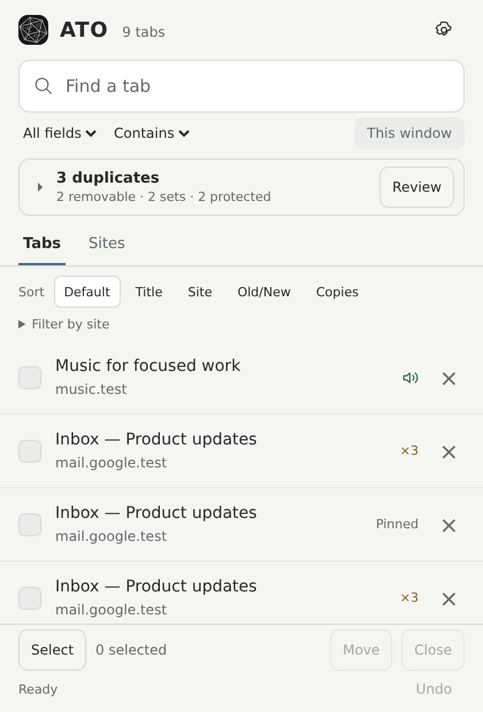
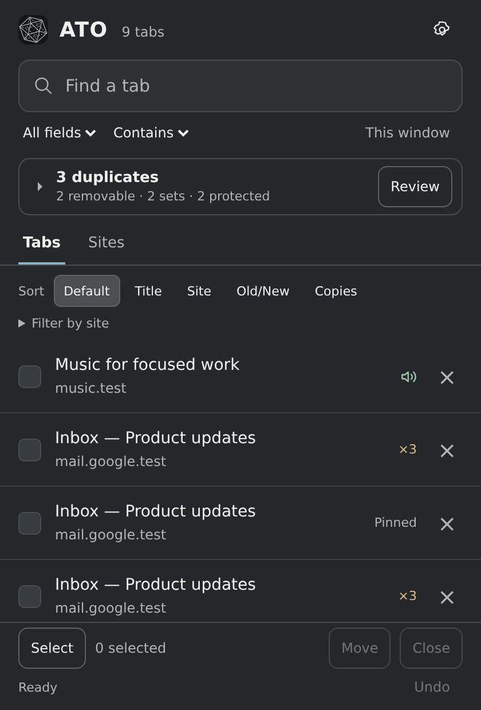
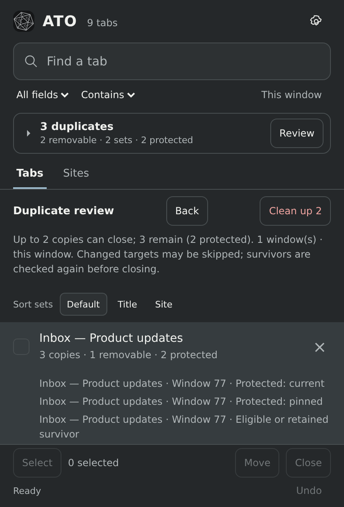
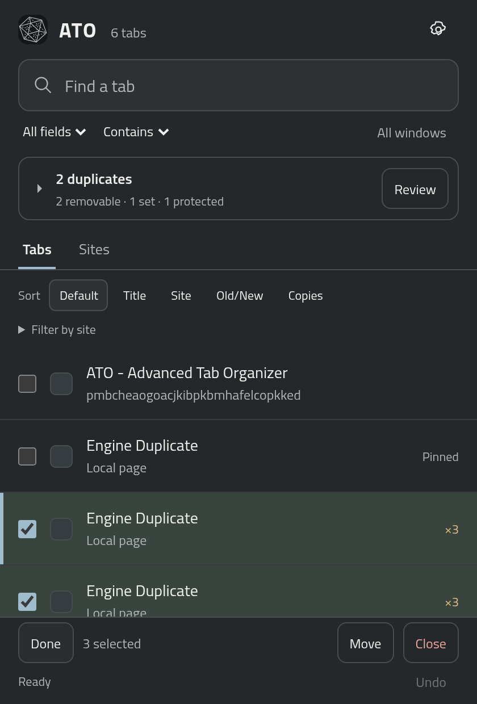

# ATO - Advanced Tab Organizer

Kill duplicate tabs instantly. Stay focused.

<p align="center">
  
</p>

## What It Does

- **Badge Counter** - Shows how many duplicate tabs you have
- **Reviewed Cleanup** - Inspect duplicate sets, removable copies, protected tabs and affected windows before cleaning up
- **Playing Media** - Audible tabs stay easy to find, with a speaker indicator and the existing audible-first ordering
- **Search** - Filter tabs by title, URL, or domain with keyboard navigation. Three modes: fuzzy (default), contains, and exact whole-word. Scope a search to a single field with `url:` or `title:`; `inurl:` and `intitle:` remain supported aliases.
- **Tabs and Sites** - Browse individual tabs or every site, including sites with just one tab; sort sites A-Z / Most / Recent
- **Remembered View** - Restore your last browsing view, sorting, scope and duplicate disclosure; never save search text or selection
- **Select Mode** - Explicit checkboxes or Cmd/Ctrl-click selection, Shift-click visible ranges, reviewed bulk close, and move to a new window
- **Move to Window & Close per Domain** - Move all tabs from a site to a new window or close them
- **Undo** - Restore the latest close operation; feedback distinguishes restored sessions from tabs reopened by URL and failures
- **Keyboard Shortcut** - `Cmd+U` (Mac) or `Ctrl+U` (Windows/Linux)
- **Real-Time Updates** - Badge updates automatically as you browse

## Demo

This earlier demo retains the project's playful identity; the screenshots below show the current 2.0 interface.

<video src="https://github.com/jeanlucaslima/ato/raw/main/docs/never-gonna-give-tabs-up.mp4" controls width="640"></video>

> If the player doesn't load, [watch the demo here](docs/never-gonna-give-tabs-up.mp4).

## Screenshots

<p align="center">
  
  
</p>

<p align="center">
  
  
</p>

Captured from the built extension in Chromium with deterministic example tabs. [Settings screenshot](docs/screenshots/settings.png).

## Using the instrument

Search receives focus on opening. Typing temporarily replaces the browsing surface; clearing the query returns to Tabs or Sites without changing the saved view. Fuzzy, contains, exact whole-word, wildcard substring (`hack*`), and field scopes (`url:` / `title:`, including `inurl:` / `intitle:`) remain available with highlighting.

The duplicate instrument is always present, even when clean or searching. Its disclosure explains scope and protection; **Review** opens a scrollable review in the main working area. Cleanup is independent of the query and site filter. Counts are estimates from the latest display snapshot; the engine checks live targets and survivors again, so changed tabs can be skipped. Review stays open after cleanup with precise feedback and Undo below.

Ordinary row clicks activate a tab. **Select** changes row clicks to selection; Cmd/Ctrl-click also enters selection, and Shift-click adds a range in the currently visible order. **Close** opens a cancel-first review; **Move** uses a new window. Scope changes clear selection, and disappearing tabs are removed from it. Exiting Select mode clears selection.

ATO restores lightweight local view/sort/disclosure preferences and the existing saved scope. It does not restore the query, cursor, selection, selection mode, or browser-content snapshots. The first-use view in Settings is the fallback until a last-used view is recorded.

Native Chrome group metadata is not available through the existing engine contract. There is no misleading Groups view or group mutation control; membership and configured protection still work. No new permissions are requested.

### Keyboard

| Key | Behavior |
| --- | --- |
| `Cmd/Ctrl + U` | Open ATO with search focused |
| `↓` / `↑` | From search, enter results; navigate visible items outside text fields |
| `j` / `k` | Navigate outside text fields |
| `Enter` | Activate the highlighted tab, or toggle it in Select mode |
| `Escape` | Return focus to search, clear its query, leave review, or exit selection depending on context |
| `/`, `Cmd/Ctrl + F` | Focus search |
| `Delete` / `Backspace` | Review a bulk selection or close the keyboard-targeted tab; never close tabs while editing text |
| `Cmd/Ctrl + Z` | Undo the latest close outside editable fields |

An explicit single-tab close retains the existing opt-in behavior, including pinned/current tabs; bulk actions use engine protection rules. Undo is not available for moves. URL reopening cannot recover all prior session metadata.

## Installation

### 1. Clone and Build

```bash
git clone https://github.com/jeanlucaslima/ato.git
cd ato
npm install
npm run icons
npm run build
```

### 2. Load in Chrome

1. Open `chrome://extensions`
2. Enable **Developer mode** (toggle in top right)
3. Click **Load unpacked**
4. Select the `dist/` folder

### 3. Use It

- Press `Cmd+U` / `Ctrl+U` to open the popup
- Or click the ATO icon in your toolbar
- Click **Review**, inspect the duplicate scope and protection, then **Clean up**

## Development

```bash
# Watch mode (auto-rebuild on changes)
npm run dev

# Run tests
npm test

# Build for production
npm run build

# Optional real-Chromium toolbar-popup/extension checks (Node 22+, agent-browser on PATH)
# Build first; runs in a disposable browser session, not your everyday Chrome profile
npm run test:popup

# Deterministic UI states, selection, themes, Settings and 5–1,200-tab fixtures
npm run test:ui
```

After changes, click the refresh icon on `chrome://extensions` to reload.

`npm test` covers pure queries, safe actions, browser event reconciliation, worker/badge integration, and popup navigation. Engine tests use a small fake Chrome adapter to exercise multiple windows, focus changes, stale responses, partial failures, and worker recovery without launching Chrome. The popup checks exercise actual Chrome mutations and keyboard/DOM behavior. The UI suite renders the real extension with injected snapshots and partial/error responses: those fixtures validate presentation, not actual Chrome failures. Set `ATO_SCREENSHOT_DIR` to a directory to capture representative states.

## Project Structure

```
src/
├── manifest.json             # Extension configuration
├── engine/
│   ├── browser.js            # Chrome boundary and recoverable snapshots
│   ├── queries.js            # URL matching, duplicates, search and sorting
│   ├── policy.js             # Scope, current-tab and protection rules
│   ├── actions.js            # Planning and live-validated, serialized mutations
│   └── undo.js               # Operation-specific session/URL restoration
├── background/
│   └── service-worker.js     # Engine command host and badge updates
├── popup/
│   ├── popup.html            # Stable instrument frame and native review dialog
│   ├── popup.css             # Layout and interaction states
│   ├── popup.js              # Interaction, rendering and engine commands
│   ├── popup-state.js        # UI state, stable selections and engine selectors
│   ├── popup-machine.js      # View/search transitions
│   ├── popup-render-elements.js # Keyed rows and site/copy presentation
│   └── popup-review.js       # Cancellable bulk close review
├── options/                  # Settings UI and storage
├── shared/
│   ├── tab-utils.js          # Compatibility exports from engine queries
│   ├── font-config.js        # Bundled font selection
│   ├── theme.css             # Shared popup/Settings visual tokens
│   └── logger.js             # Debug-gated logging
└── assets/                   # Icons and fonts

scripts/test-popup.mjs        # Optional real-browser regression checks
scripts/test-ui.mjs           # UI-state and large-collection browser checks
```

## Architecture — Tab Engine 2.0

**Chrome owns the tabs. The engine owns tab rules and safe operations. The popup owns interaction.** The popup and service worker share duplicate matching, search, sorting, scope, and protection rules. The worker executes commands so closing the popup does not make it the owner of an in-progress operation.

Browser events keep lightweight snapshots current. Structural changes and focus changes resynchronize from Chrome; metadata changes read the affected tab. Old asynchronous responses cannot overwrite newer snapshots. Destructive actions never trust those display snapshots: they validate live tab identities, protection, and duplicate survivors before closing anything, and report actual successes, skips, and failures.

Cleanup now preserves the active tab in the **focused or last-focused window**, rather than whichever active tab happens to appear first across all windows. Current-tab, pinned/grouped protections, and existing Chrome/Edge internal-page exclusions take precedence over oldest/newest preferences. The badge and review show **raw duplicates**; cleanup controls distinguish how many are actually closable. If focus or URLs change during an operation, it may conservatively skip tabs rather than add new targets.

Keyboard navigation uses stable tab IDs and stays within search results; clearing search, rerendering, and removing the last result no longer leave the cursor targeting unrelated browse controls. Undo survives popup reopening and worker restart within the browser session. It restores identified Chrome sessions when available, otherwise explicitly reports tabs **reopened by URL**; it never restores unrelated recent closures by count.

No new dependencies or permissions are required. See [the engine architecture notes](docs/architecture.md) for command contracts, protection precedence, and Chrome API limitations.

## License

MIT
