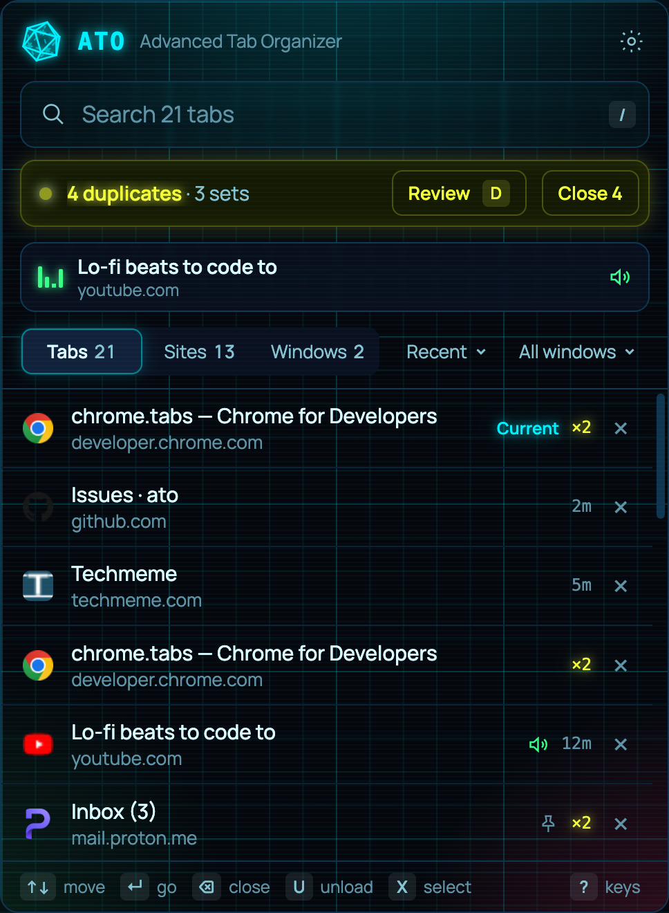
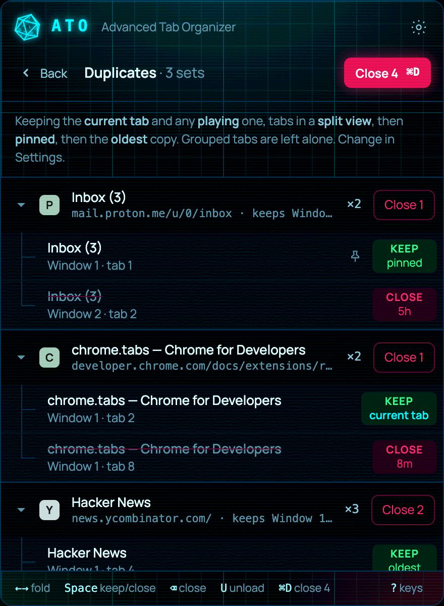
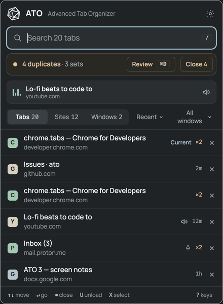
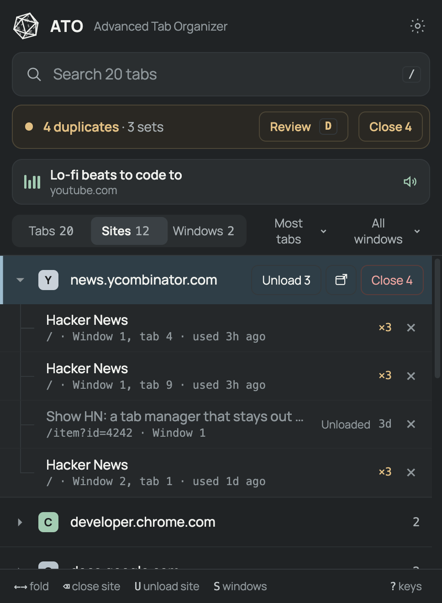
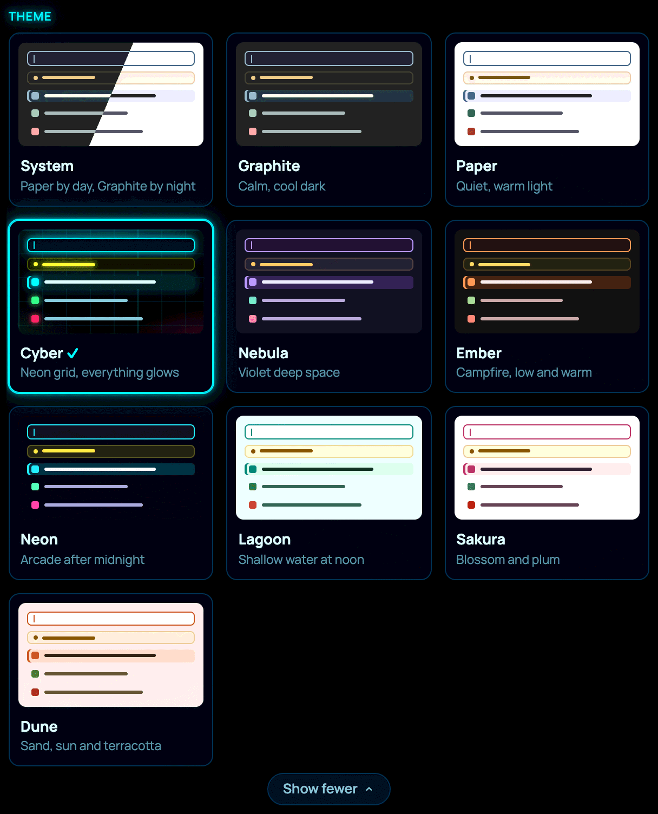
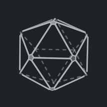

# ATO - Advanced Tab Organizer

<p align="center">
  
  
</p>

I keep far too many tabs open. The same docs page ends up open three times in two windows, a video plays somewhere I can't find, and Chrome's tab strip turns into a row of identical favicons. ATO is the popup I built for that: press **⌘U** (Ctrl+U on Windows and Linux), see everything across every window, and clean it up from the keyboard without losing anything I meant to keep.

It's a Chrome extension, it needs **Chrome 157 or newer**, and it runs entirely in your browser: no analytics, tracking or backend.

## What I use it for

**"I have the same page open five times."** The bar at the top counts the extra copies. **Close N** closes them; **Review** first shows each page with its copies, which one stays and why (current tab, playing, pinned, in a split view, or simply the oldest). Flip any copy between keep and close, or close one page's copies at a time. What counts as "the same page" is up to you: the whole URL, or ignoring its `#hash`, its `?query`, or both.

**"Where was that tab?"** Start typing. Search covers titles and URLs in every window and highlights what matched; ↑↓ and ↵ take you there. `"quotes"` match whole words, and `url:`, `title:` and `dupe:` narrow the search. Whatever it finds can be closed, unloaded or moved to a new window in one go.

<p align="center">
  
</p>

**"Which tab is making that noise?"** **Now playing** lists tabs playing sound, in any window, with a mute button. Its equalizer bars rest while a tab is muted.

**"My windows are a mess."** **Sites** groups tabs by site, so a whole site can be closed, unloaded or moved to its own window. **Windows** shows each window as a little map of its tab strip: one dot per tab, tab groups outlined in their colour, collapsed groups as a pill. From there you can focus a window, merge it into the current one (groups stay groups), or close it, and protected tabs stay.

<p align="center">
  
  
</p>

**"Chrome is using too much memory."** **Unload** (U) discards a tab, a site, a selection or search results: they stay in the strip and reload when you visit them.

**"I want to do this without the mouse."** Everything has a key. ↑↓ wrap around, ←→ fold, ⌫ closes whatever the cursor is on, Space selects, ⌘D opens the duplicate review and ⌘D again closes them all, and `?` lists every shortcut. The footer always shows the keys that work right now.

Also: a toolbar badge with the duplicate count (or all tabs) in your colour, and a tab right-click menu to close the duplicates of a tab or the other tabs from its site.

## Ten themes, and one that glows

<p align="center">
  
</p>

Graphite and Paper are the quiet ones, and **System**, the default, switches between them with your OS. **Onyx** is true black, for OLED screens. Nebula, Ember, Neon, Lagoon, Sakura and Dune each have their own palette, and the picker previews every theme as a tiny popup in its own colours.

**Cyber** goes further than a palette: neon on near-black over a faint grid, glowing edges, text and focus rings, scanlines across the popup, and a pulsing dot on the duplicates bar. All of that is plain CSS scoped to the theme, and it respects reduced motion.



The logo on the settings page is a real 3D icosahedron built from 20 CSS triangles, each placed with a `matrix3d`. Edges facing you are solid, hidden edges are dashed. It turns slowly on its own; drag it to spin it, let go mid-swipe and it keeps going, easing back to the slow turn over a few seconds. The small logo in the popup's header is a static SVG rendered from the same geometry.

<br clear="right">

## Built to stay fast

ATO is vanilla TypeScript with no UI framework, so keeping it quick with thousands of tabs is my job:

- **A custom DOM morph** (`ui/morph.ts`) patches the live DOM in place by key, so focus, scroll position, typing and CSS transitions survive every render.
- **A cursor fast path:** moving the cursor (↑↓ or hovering) changes only two rows, so `app.ts` patches those two instead of rendering.
- **Memoized view models:** states are immutable, so each one's model is derived once and cached.
- **Drawing less:** search draws the first 150 results (actions still cover all of them), and long lists use `content-visibility`.
- **Benchmarks:** `npm run perf` times every hot path at 500 to 5,000 generated tabs. At 2,000 tabs, moving the cursor costs about 2 ms and a keystroke in search about 7 ms of script.

Measured in real Chrome at 2,000 tabs, ↓ renders within a frame (median 7.6 ms, p95 11 ms). Typing in search doesn't yet: about 28 ms per keystroke, and more on a slow machine or at 5,000 tabs. The traces point at re-parsing icon SVGs and URL parsing, and fixing that is planned for 3.1. The numbers and traces are in [docs/v3-status.md](docs/v3-status.md#301-measurements).

## Careful about what it closes

Closing the wrong tab is the one thing a tab manager must not do, so the rules live in a small pure core and are tested as properties rather than examples:

- The current tab of a window, a tab playing sound and a tab in a split view are never closed by cleanup; pinned and grouped tabs are protected too, by default.
- Every duplicate set keeps a copy, and only real duplicates under your matching are closed.
- The 180 ms close animation is decorative: right before removing anything, ATO reads Chrome's tabs again and rechecks every rule. A tab that started playing in the meantime stays, and so does a copy of a page whose planned survivor you closed.
- **Undo** (⌘Z) brings back what was closed, however many tabs: the last 25 from Chrome's session history, with their back/forward history; older ones are reopened in their window, position and tab group. It runs in the background, so closing the popup doesn't interrupt it.

The safety rules are [fast-check](https://fast-check.dev) properties over generated browser states. Each one also gets a mutation check: remove the guard and confirm the property fails. The undo and close paths were also checked in a real Chrome with a throwaway profile.

## How it works

- **Pure core** (`src/core/`): plain functions over plain data, no DOM or Chrome. It decides what may be closed (duplicate planning, URL matching, protection) and holds search, settings and the badge count.
- **State machine** (`src/ui/update.ts`): `update(state, action)` returns the next state and a list of effects (close, restore, move…). It never touches the browser itself.
- **Rendering:** `deriveModel` turns the browser snapshot and UI state into a view model, `renderPopup` draws it as a pure function, and `morph` patches the page.
- **Chrome integration:** only `src/ui/chrome-*.ts` and the service worker call `chrome.*`. Every close and undo runs in the worker through one path. The popup talks to Chrome through a `BrowserPort` interface, so the dev gallery and the tests run it over an in-memory `FakeBrowser`.

```
src/
├── manifest.json
├── background/worker.ts   # badge, tab right-click menu, closing and undo
├── core/                  # pure rules: duplicates, matching, search, settings, badge, menu
├── ui/                    # popup state machine, render, Chrome adapters, settings page
├── popup/ options/        # extension entry points
└── dev/                   # gallery fixtures, fake browser, perf harness
```

Details, including how closing and undo work: [docs/architecture.md](docs/architecture.md).

## Keyboard

The popup opens with search focused; ↑↓ work from there.

| Key | Does |
| --- | --- |
| ⌘U / Ctrl+U | Open ATO |
| ↑ ↓ (also j k) | Move; wraps around the ends. The duplicates bar and Now playing come first |
| ↵ | Go to the tab or window · open review from the duplicates bar · fold a site or set |
| ← → | Fold / unfold a site, window or duplicate set |
| ⌫ | Close the tab, site, selection, or a duplicate set's extra copies |
| U | Unload (free memory, keep the tab) |
| M | Move to a new window · merge a window into this one |
| Space | Select · flip keep/close in review |
| D / ⌘D | Review duplicates (⌘D also while typing); ⌘D again closes them all |
| S | Switch Tabs / Sites / Windows |
| X | Select mode (⇧↑↓ extends, ⌘A all) |
| / | Search (or just start typing) |
| ⌘Z | Undo the last close |
| Esc | Clear search · leave a mode · back |
| ? | All shortcuts |

## Build and install

```bash
git clone https://github.com/jeanlucaslima/ato.git
cd ato
npm install
npm run build
```

Then in Chrome: `chrome://extensions` → **Developer mode** → **Load unpacked** → pick `dist/`. This dev build is named "ATO 3 (dev)" and opens with ⇧⌘U, so it can sit beside the store version. `npm run zip` builds the store package (named "ATO", ⌘U).

## Development

```bash
npm run dev     # live gallery: every popup state as a working popup, plus the settings page
npm test        # Vitest, including the fast-check properties
npm run perf    # timings at 500–5,000 tabs
```

Every screenshot here comes from the gallery. Contributions are welcome: [CONTRIBUTING.md](CONTRIBUTING.md) has the setup, and [AGENTS.md](AGENTS.md) the rules and conventions (for people and coding agents alike).

## Privacy

ATO has no analytics, tracking or backend. Your tabs never leave your browser. Favicons are shown from the addresses Chrome provides, so your browser may load them as it would on the tab strip. ATO collects nothing. See [PRIVACY.md](PRIVACY.md).

## License

MIT
