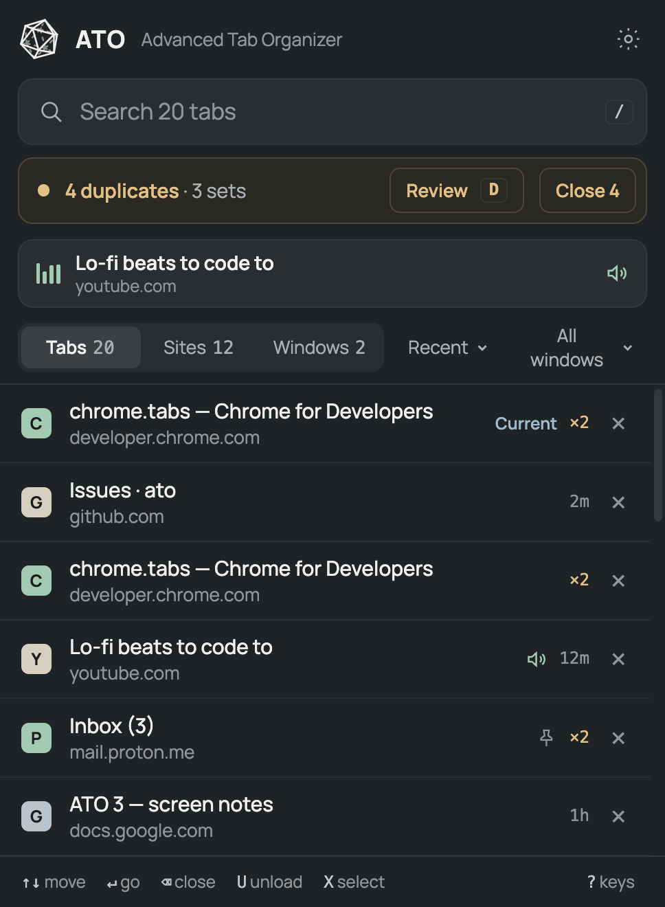
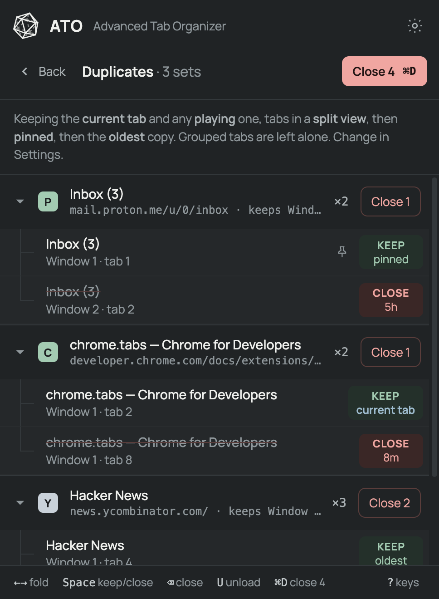
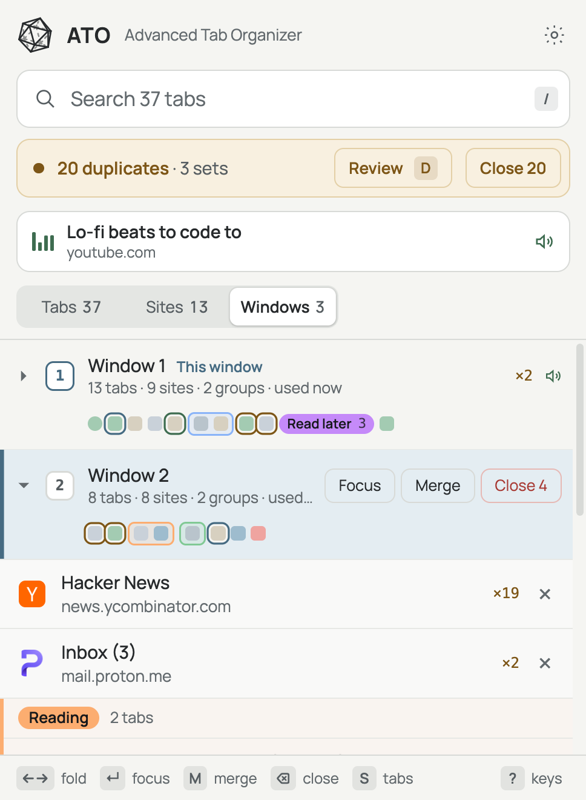
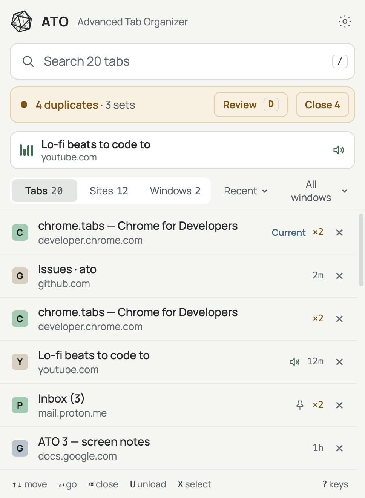

# ATO - Advanced Tab Organizer

Kill duplicate tabs instantly. Stay focused.

<p align="center">
  
</p>

ATO is a Chrome extension for people with too many tabs. Open it with **⌘U** (Mac) or **Ctrl+U** (Windows/Linux), see how many duplicates you have, and close them, safely, in one go. Everything runs in your browser: no analytics, tracking or backend, and your tabs never leave it.

Requires **Chrome 157 or newer**.

## What it does

- **Duplicates, safely.** The bar at the top counts extra copies; **Close N** closes them, or **Review** shows each page with its copies, which one stays and why. The current tab, tabs playing sound, tabs in a split view, pinned tabs and (optionally) grouped tabs are never closed. Flip any copy between keep and close, close one page's copies, or all of them.
- **Matching your way.** Copies are the same URL, or the same URL ignoring its `#hash`, its `?query`, or both.
- **Tabs, Sites and Windows.** Every tab by recency, title or site; every site with its tabs; every window with a map of its tab strip and its tab groups. Merge a window into this one, move a site or a selection to a new window, unload what you're not using.
- **Search.** Type to search titles and URLs across every window. `"exact"` matches whole words; `url:`, `title:` and `dupe:` narrow it.
- **Now playing.** Tabs making sound, with mute.
- **Undo.** Bring back what you closed, however many tabs: recent ones with their history, the rest reopened where they were, in their tab group.
- **Toolbar badge** with the duplicate count (or all tabs), in your colour.
- **Tab right-click menu:** close duplicates of this tab, or other tabs from this site. Open the popup within a minute to undo it.
- **Nine themes**, light and dark, or follow your system.

## Screenshots

<p align="center">
  
  
</p>
<p align="center">
  
  
</p>

[Settings page](docs/screenshots/settings.png).

## Keyboard

The popup opens with search focused; ↑↓ work from there.

| Key | Does |
| --- | --- |
| ⌘U / Ctrl+U | Open ATO |
| ↑ ↓ (also j k) | Move; wraps around the ends. The duplicates bar and Now playing come first |
| ↵ | Go to the tab or window · open review from the duplicates bar · fold a site or set |
| ← → | Fold / unfold a site, window or duplicate set |
| ⌫ | Close the tab, site, selection, or a duplicate set's extra copies |
| U | Unload (free memory, keep the tab) |
| M | Move to a new window · merge a window into this one |
| Space | Select · flip keep/close in review |
| D / ⌘D | Review duplicates (⌘D also while typing); ⌘D again closes them all |
| S | Switch Tabs / Sites / Windows |
| X | Select mode (⇧↑↓ extends, ⌘A all) |
| / | Search (or just start typing) |
| ⌘Z | Undo the last close |
| Esc | Clear search · leave a mode · back |
| ? | All shortcuts |

## Build and install

```bash
git clone https://github.com/jeanlucaslima/ato.git
cd ato
npm install
npm run build
```

Then in Chrome: `chrome://extensions` → **Developer mode** → **Load unpacked** → pick `dist/`. This dev build is named "ATO 3 (dev)" and opens with ⇧⌘U, so it can sit beside the store version. `npm run zip` builds the store package (named "ATO", ⌘U).

## Development

```bash
npm run dev     # live gallery of every popup state + the settings page (Vite)
npm test        # Vitest, including fast-check properties for the safety rules
npm run perf    # timings at 500–5,000 tabs
```

## How it works

Vanilla TypeScript, built with Vite, no UI framework.

- **Pure core** (`src/core/`): plain functions over plain data, no DOM or Chrome. It decides what may be closed (duplicate planning, URL matching, protection) and also holds search, settings and the badge count.
- **State machine** (`src/ui/update.ts`): `update(state, action)` returns the next state and a list of effects (close, restore, move…). It never touches the browser itself.
- **Rendering**: `deriveModel` turns the browser snapshot and UI state into a view model, `renderPopup` draws it as a pure function, and `morph` patches the live DOM in place, keeping focus and scroll.
- **Chrome integration**: only `src/ui/chrome-*.ts` and the service worker call `chrome.*`. Every close and undo runs in the worker through one path, which rechecks protection on Chrome's current tabs right before removing anything. The popup talks to Chrome through a `BrowserPort` interface, so the gallery and tests run it over an in-memory `FakeBrowser`.
- **Testing**: Vitest, with fast-check properties for the safety rules (never close the current tab, a playing tab or a split view; every duplicate set keeps a tab; only real duplicates close; protected tabs stay; undo brings each tab back at most once). Each property has a mutation check: remove the guard and the property fails.

```
src/
├── manifest.json
├── background/worker.ts   # badge, tab right-click menu, closing and undo
├── core/                  # pure rules: duplicates, matching, search, settings, badge, menu
├── ui/                    # popup state machine, render, Chrome adapters, settings page
├── popup/ options/        # extension entry points
└── dev/                   # gallery fixtures, fake browser, perf harness
```

Details, including how closing and undo work: [docs/architecture.md](docs/architecture.md). Conventions for contributors and coding agents: [AGENTS.md](AGENTS.md).

## Privacy

ATO has no analytics, tracking or backend. Your tabs never leave your browser. Favicons are shown from the addresses Chrome provides, so your browser may load them as it would on the tab strip. ATO collects nothing. See [PRIVACY.md](PRIVACY.md).

## License

MIT
